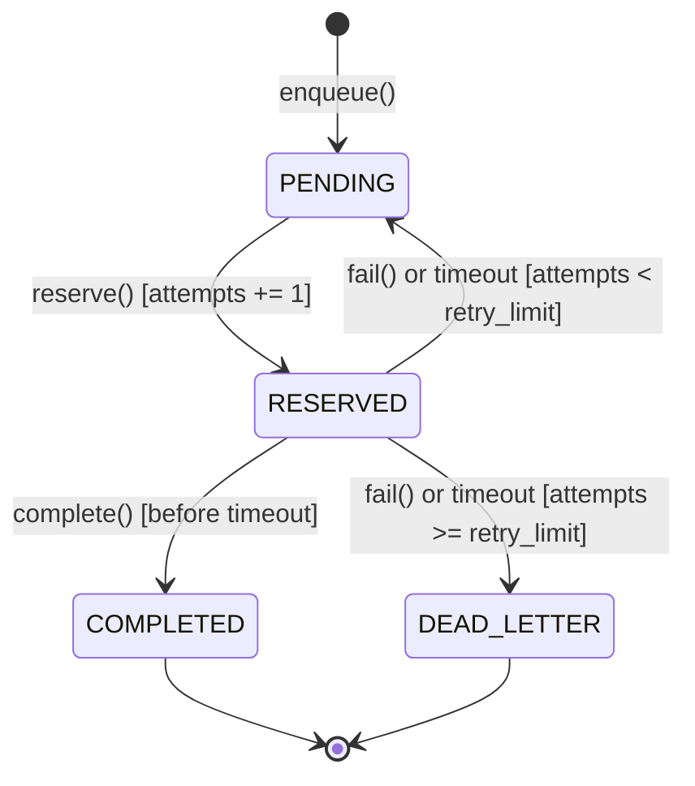

# Work Queue

This package provides a thread-safe work queue with lease timeouts, bounded retries, fencing tokens, and a dead-letter queue.

## Architecture

The package separates domain state-machine rules from storage backends:

- [`work_queue/models.py`](file:///Users/guofei/workspace/ddia/work_queue/work_queue/models.py): Defines [`Job`](file:///Users/guofei/workspace/ddia/work_queue/work_queue/models.py#L65-L264), [`JobStatus`](file:///Users/guofei/workspace/ddia/work_queue/work_queue/models.py#L16-L23), [`QueueConfig`](file:///Users/guofei/workspace/ddia/work_queue/work_queue/models.py#L26-L39), and [`QueueStats`](file:///Users/guofei/workspace/ddia/work_queue/work_queue/models.py#L42-L58).
- [`work_queue/exceptions.py`](file:///Users/guofei/workspace/ddia/work_queue/work_queue/exceptions.py): Defines domain exceptions for capacity limits, missing jobs, expired reservations, and stale leases.
- [`work_queue/base.py`](file:///Users/guofei/workspace/ddia/work_queue/work_queue/base.py): Defines the abstract [`WorkQueue`](file:///Users/guofei/workspace/ddia/work_queue/work_queue/base.py#L41-L133) contract and [`ManualClock`](file:///Users/guofei/workspace/ddia/work_queue/work_queue/base.py#L16-L38).
- [`work_queue/memory.py`](file:///Users/guofei/workspace/ddia/work_queue/work_queue/memory.py): Implements [`InMemoryWorkQueue`](file:///Users/guofei/workspace/ddia/work_queue/work_queue/memory.py#L15-L216) using a reentrant lock and two min-heaps.
- [`work_queue/sqlite_queue.py`](file:///Users/guofei/workspace/ddia/work_queue/work_queue/sqlite_queue.py): Implements [`SQLiteWorkQueue`](file:///Users/guofei/workspace/ddia/work_queue/work_queue/sqlite_queue.py#L24-L355) using `BEGIN IMMEDIATE` transactions and WAL mode.

## Job State Machine



## Concurrency and Fencing Tokens

1. Each call to `reserve()` increments the job attempt counter and assigns a monotonic `lease_token`.
2. When the clock reaches `expires_at`, the queue reconciles the expired reservation before executing subsequent operations.
3. If `attempts < retry_limit`, the expired job returns to `PENDING`.
4. If `attempts >= retry_limit`, the expired job moves to `DEAD_LETTER`.
5. If a slow worker calls `complete()` or `fail()` with an outdated `lease_token`, the queue raises `StaleLeaseError`.

## Usage

```python
from work_queue import InMemoryWorkQueue, SQLiteWorkQueue

queue = InMemoryWorkQueue(
    retry_limit=3,
    reservation_timeout=30.0,
    max_capacity=1000,
)

job = queue.enqueue({"user_id": 42, "action": "send_email"}, job_id="email-42")
reserved = queue.reserve(worker_id="worker-1")

if reserved is not None:
    queue.complete(reserved.job_id, reserved.lease_token)
```

## Verification

Run the test suite with the virtual environment Python interpreter:

```bash
.venv/bin/python -m unittest discover -s tests -v
```
